# Call Flow Designer: a plain-English guide

The Call Flow Designer lets you draw what happens when someone calls you:
what they hear, which keys they can press, where the call goes at night,
which caller gets priority, what is saved in your CRM. You build it with
your mouse, from ready-made blocks called **components**. No programming
is needed for the everyday things; small "values" (section 6) let you go
further when you want to.

You can make as many call flows as you like (a main line, a support line, a
holiday line...). Each one gets a **number**, and you send any of your DID
numbers (the phone numbers callers dial) to it.

**Where:** menu **Call Flow → View 2**. You need to be signed in as the
administrator or as an **Owner**.

---

## Contents

1. [Words used in this guide](#1-words-used-in-this-guide)
2. [The screen](#2-the-screen)
3. [Your first call flow, step by step](#3-your-first-call-flow-step-by-step)
4. [Working on the canvas](#4-working-on-the-canvas)
5. [Prompts: what the caller hears](#5-prompts-what-the-caller-hears)
6. [Values: what the call flow remembers](#6-values-what-the-call-flow-remembers)
7. [Every component, one by one](#7-every-component-one-by-one)
8. [The three tabs: main flow, error handler, disconnect handler](#8-the-three-tabs-main-flow-error-handler-disconnect-handler)
9. [Checking, saving and testing](#9-checking-saving-and-testing)
10. [Sending your DID numbers to a call flow](#10-sending-your-did-numbers-to-a-call-flow)
11. [Ready-made examples](#11-ready-made-examples)
12. [Copying, moving and deleting call flows](#12-copying-moving-and-deleting-call-flows)
13. [When something does not work](#13-when-something-does-not-work)
14. [Keyboard shortcuts](#14-keyboard-shortcuts)

---

## 1. Words used in this guide

| Word | Meaning |
|---|---|
| **Call flow** | One drawing: everything that happens to a call, from the moment it arrives until it is transferred or hung up. |
| **Component** | One block on the drawing: "play a greeting", "ask for a key", "send the call to the Sales queue"... |
| **Branch** | A way out of a component. A menu has one branch per key, plus one for a wrong key and one for no key. Components placed on a branch only run when the call goes that way. |
| **Prompt** | A sound played to the caller: a recorded file, digits said one by one, silence or a beep. |
| **Value** | Something a component remembers for later, such as the key pressed (`MainMenu.Result`) or the digits typed (`AskAccount.Buffer`). |
| **Variable** | A value you name yourself and change as the call goes (for example a counter of attempts). |
| **Destination** | Somewhere a call can be sent: an extension, queue, ring group, IVR menu, voicemail box, AI agent, another call flow... |

---

## 2. The screen

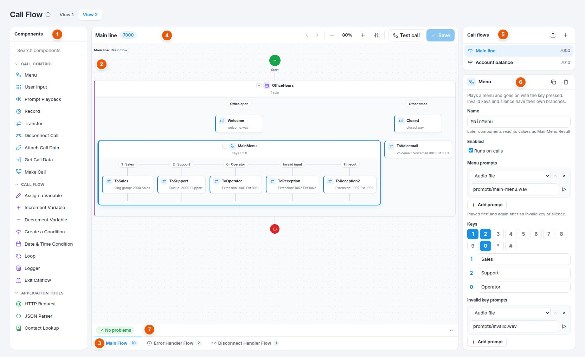

1. **Components.** The blocks you can use, in three groups: *Call control*
   (talking to the caller and moving the call), *Call flow* (decisions,
   counters, notes) and *Application tools* (your web systems and your
   address book). Type in the search box to find one. Click a group's name
   to fold it.
2. **The canvas.** Your drawing. The call starts at the green **Start**
   circle at the top and ends at the red **End** circle at the bottom (there
   the call is hung up). Components sit on the line between them, from top
   to bottom, in the order they run.
3. **Tabs under the canvas.** **Main Flow** is what callers go through.
   **Error Handler Flow** and **Disconnect Handler Flow** are two extra
   drawings for special moments (section 8). The small number on a tab
   says how many components it has.
4. **Toolbar.** Undo and redo, zoom (**−**, **80%**, **+**; click the
   percentage to go back to 100%), **Call flow settings**, **Test call** and
   **Save**. An orange dot next to the call flow's name means there are
   unsaved changes.
5. **Call flows.** Your call flows with their numbers. Click one to open
   it. **+** makes a new one; the arrow imports one from a file.
6. **Properties.** The settings of the component you selected on the
   canvas (click a component to select it). When nothing is selected, this
   shows the **call flow's settings**: name, number, description, enabled,
   which DIDs send calls to it, and its variables.
7. **Problems bar.** "No problems" in green, or the number of problems in
   red. Click it to see the list; click a problem to jump to the component.

---

## 3. Your first call flow, step by step

Example: callers hear a welcome, then "press 1 for Sales, 2 for Support";
nobody pressing anything goes to reception.

**Step 1. Make the call flow.** Click **+** above the list of call flows.
Give it a name (e.g. *Main line*). A free number is suggested (7000, 7001...);
keep it or type another one that is not used by an extension, queue or
other number. Click **Create**. It is saved at once and opens on an empty
canvas.

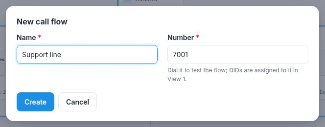

**Step 2. Add a welcome.** Drag **Prompt Playback** from the left onto
"Drag and drop components here". (Or simply click it: a click adds the
component after the one selected, or at the end.) While you drag, blue
dashed boxes show every place you can drop it.

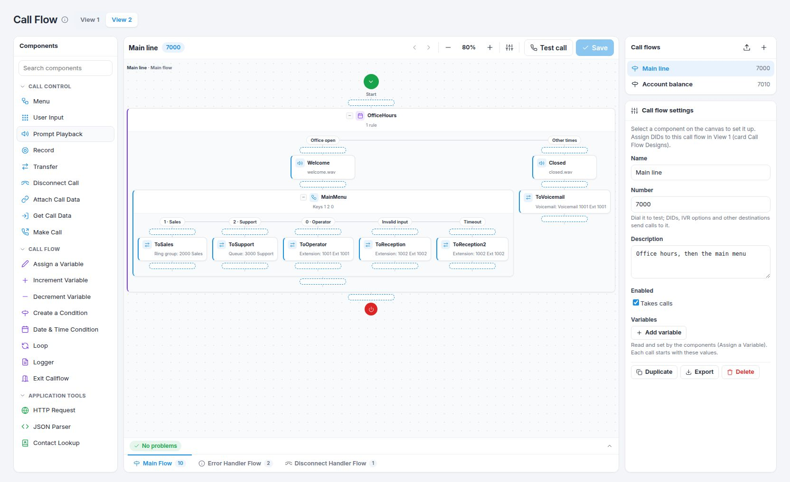

**Step 3. Choose the welcome sound.** The new component is selected, and
its settings are on the right. Under **Prompts** click **Add prompt**,
leave *Audio file*, and type or pick the file, e.g. `prompts/welcome.wav`
(files you uploaded in **Settings → Sounds & music** are offered as you
type). The **▶** button plays it in your browser.

**Step 4. Add the menu.** Drag **Menu** under the welcome. Under **Menu
prompts** add the menu recording ("press 1 for Sales, 2 for Support").
Under **Keys**, keys **1** and **2** are already on (blue); click a key to
add or remove it, and give each one a name (*Sales*, *Support*): the name is
shown on the canvas.

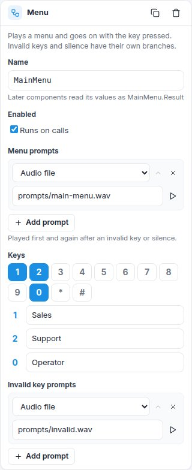

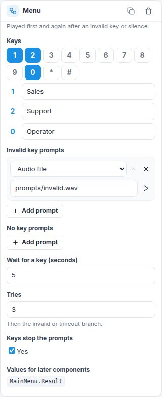

On the canvas the menu now has one column per key, plus **Invalid input**
and **Timeout**.

**Step 5. Send each key somewhere.** Drag **Transfer** into the column of
key **1**. On the right choose **Destination → Ring group: Sales** (or your
Sales queue). Do the same under key **2** with the Support queue, and under
**Timeout** with the reception extension.

**Step 6. Save.** Click **Save** (or press **Ctrl S**). The message
**Saved** appears at the bottom. If it says "Saved, with 2 problems",
open the problems bar and fix them (section 9).

**Step 7. Try it.** Click **Test call**: your phone (the extension you are
signed in with) rings; answer and you go through the call flow as a caller
would. You can also dial the call flow's number (e.g. 7000) from any
extension.

**Step 8. Send your DID to it.** Go to **View 1**, and drag your DID number
onto the **Call Flow Designs** card (section 10). Calls to that number now
go through your call flow.

---

## 4. Working on the canvas

| To... | Do this |
|---|---|
| **Add** a component | Drag it from the left onto a place on the line (blue dashed boxes show where), or click it to add it after the selected component. |
| **Select** a component | Click it. Its settings appear on the right. Click an empty part of the canvas (or press **Esc**) to select none. |
| **Move** a component | Drag it by its name to another place, also into another branch. A component cannot be moved inside itself. |
| **Delete** a component | Select it and press **Delete**, or click the bin at the top of its settings. Deleting a component also deletes what is on its branches. **Undo** brings it back. |
| **Copy** a component | Select it, **Ctrl C**, select where it should go after, **Ctrl V**. Or click the copy button at the top of its settings (a duplicate appears right after it). Copies get new names (Menu2, Menu3...). |
| **Undo / redo** | **Ctrl Z** / **Ctrl Y**, or the arrows in the toolbar. |
| **Fold** a big component | Click the small **−** before its name; **+** opens it again. Folding only changes the view. |
| **Zoom** | **−** and **+** in the toolbar; click the percentage for 100%. Scroll the canvas to move around. |
| **Rename** a component | Change its **Name** at the top of its settings (letters, digits and `_`, starting with a letter, e.g. `MainMenu`). Everything that uses its values is updated for you. |
| **Switch off** a component | Untick **Enabled** in its settings. It stays on the drawing (faded, name crossed out) but calls skip it. Handy for testing. |

A small red **!** on a component means it has a problem; an orange one is
only a warning. Point at it to read why.

---

## 5. Prompts: what the caller hears

Menu, User Input, Prompt Playback and Record have lists of prompts, played
one after another. Each prompt is one of:

| Type | What is played | Example |
|---|---|---|
| **Audio file** | A sound file from your sounds folder. Upload yours in **Settings → Sounds & music**; they are named `prompts/<name>.wav`. | `prompts/welcome.wav` |
| **Audio file from a value** | A file whose name comes from a value, typically a recording made earlier in the same call. | `Record1.FileName` |
| **Say digits** | Digits said one by one with the built-in voice. | `UserInput1.Buffer` says back what the caller typed |
| **Silence (ms)** | A pause, in thousandths of a second (500 = half a second). | `800` |
| **Beep** | A short beep. | |

Use **Add prompt** to add one, the up arrow to move it earlier, **×** to
remove it. If a file is missing, it is skipped (the call goes on) and the
switch's log says which one.

---

## 6. Values: what the call flow remembers

Most of the time you only choose things from lists. But some fields (marked
**ƒx**) let you use **values**: what a component found out earlier, facts
about the call, or your own variables.

### Values of components

Each component that finds something out keeps it under its name, a dot,
and the value's name. The list is at the bottom of its settings (**Values
for later components**; click one to copy it).

| Component | Values |
|---|---|
| Menu | `.Result`: the key pressed (`1`, `2`... or `invalid` / `timeout`) |
| User Input | `.Buffer`: the digits typed (without #); `.Result`: `valid`, `invalid` or `timeout` |
| Prompt Playback | `.Digit`: the key that stopped the prompts |
| Record | `.FileName`, `.Duration` (seconds), `.Result` (`recorded` / `nothing`) |
| Attach / Get Call Data | `.Value` |
| Make Call | `.Result` (`answered` or the reason it failed), `.CallID` |
| Loop | `.Index`: the round (0, 1, 2...) |
| HTTP Request | `.Status` (200, 404... or 0 when the address could not be reached), `.Body` (the answer), `.Error` |
| JSON Parser | `.Value` |
| Contact Lookup | `.Found` (`true` / `false`), `.Name`, `.Company`, `.Email` |

### Values about the call

| Value | Meaning |
|---|---|
| `session.ani` | The caller's number |
| `session.callerName` | The caller's name (as their phone or carrier sent it) |
| `session.did` | The DID number the call came in on |
| `session.dnis` | The number dialled to reach the call flow |
| `session.callId` | The call's unique id |
| `session.domain` | Your company (domain) |
| `session.flowName`, `session.flowNumber` | This call flow's name and number |
| `session.startTime` | When the call reached the call flow |
| `session.lastError` | In the error handler: what went wrong |

### Variables

A variable is a value you name yourself, for example `attempts` or
`customer_type`. Declare it in the **call flow's settings** (click an empty
part of the canvas) with **Add variable**, and give it a starting value.
Every call starts with those values. Then change it with **Assign a
Variable**, **Increment Variable** or **Decrement Variable**.

### Expressions (fields with ƒx)

An expression works out a value, a bit like a calculator:

| You write | Result |
|---|---|
| `"Hello"` | the text Hello (text always goes in double quotes) |
| `attempts + 1` | one more than `attempts` |
| `MainMenu.Result == "1"` | true when key 1 was pressed |
| `attempts >= 3` | true when `attempts` is 3 or more |
| `Contact1.Found && tier == "gold"` | true when both are true (`&&` = and; `AND` works too) |
| `session.ani == "6591234567" \|\| session.ani == "6598765432"` | true for either number (`\|\|` = or; `OR` works too) |
| `!Contact1.Found` | true when the contact was not found (`!` = not; `NOT` works too) |

Comparisons: `==` equal (`=` works too), `!=` different, `<` `>` `<=` `>=`.
Numbers are compared as numbers, everything else as text. `+` adds numbers
and joins text. An empty value, `false`, `0`, `no` and `off` count as false;
anything else as true.

### Text with values inside (templates)

Some fields are text in which values are filled in when the call gets
there: write the value inside `${` and `}`.

- `https://crm.example.com/caller?number=${URLENCODE(session.ani)}`
- `Caller ${session.ani} chose ${MainMenu.Result}`
- `message-${session.callId}.wav`

(To write a real `$`, write `$$`.)

### The ƒx button

Not sure what to type? Click **ƒx** next to the field: it lists every value
you can use (the components' values, your variables, the call's values) and
every function, with a short explanation. Click one to insert it.

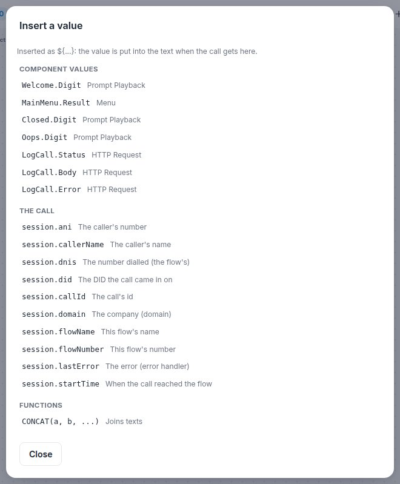

### Functions

| Function | What it gives | Example → result |
|---|---|---|
| `LEFT(text, n)` / `RIGHT(text, n)` | The first / last n characters | `RIGHT(session.ani, 4)` → `4567` |
| `MID(text, start, n)` | n characters from position start (1 = first) | `MID("ABCDEF", 2, 3)` → `BCD` |
| `LEN(text)` | How many characters | `LEN(AskAccount.Buffer)` → `8` |
| `CONCAT(a, b, ...)` | Joins texts | `CONCAT("ACC-", AskAccount.Buffer)` |
| `UPPER`, `LOWER`, `TRIM` | Capitals, small letters, without spaces around | |
| `DIGITS(text)` | Only the digits | `DIGITS("+65 6123-4567")` → `6561234567` |
| `CONTAINS`, `STARTSWITH`, `ENDSWITH` | true / false | `STARTSWITH(session.ani, "65")` |
| `INDEXOF(text, part)` | Position of part (0 = not there) | |
| `REPLACE(text, old, new)` | Replaces every old by new | |
| `ISEMPTY(text)`, `ISNUMBER(text)` | true / false | |
| `EQUALS(a, b)` | Equal, ignoring capitals | |
| `IF(condition, a, b)` | a when the condition is true, else b | `IF(Contact1.Found, Contact1.Name, "caller")` |
| `ROUND(n, decimals)`, `ABS`, `MIN`, `MAX` | Numbers | |
| `RANDOM(from, to)` | A whole number between from and to | |
| `NOW("yyyy-MM-dd HH:mm")` | Your company's date and time | |
| `HOUR()`, `MINUTE()`, `DAY()`, `MONTH()`, `YEAR()`, `WEEKDAY()` | Parts of the date and time (WEEKDAY: 1 = Monday ... 7 = Sunday) | `HOUR() < 12` |
| `URLENCODE(text)`, `URLDECODE(text)` | Make text safe inside a web address (and back) | always use it for numbers in addresses: `+` would be lost otherwise |
| `CHANNEL("name")` | A call variable (call data or any variable of the call) | `CHANNEL("crm_account")` |

Dates and times always use the time zone of your company (**Settings →
Language & office hours**).

---

## 7. Every component, one by one

Every component has a **Name** and **Enabled** at the top of its settings
(section 4). Below that come its own settings.

### Call control

#### Menu

Plays a menu and goes on with the key the caller presses.

| Setting | Meaning |
|---|---|
| Menu prompts | Played first, and again before each new try. |
| Keys | Click the keys callers may press (0-9, \*, #). Each key you turn on gets its own branch; give it a name (Sales, Support...). |
| Invalid key prompts | Played after a key that is not on, before trying again ("Sorry, that is not a valid choice"). |
| No key prompts | Played when nothing was pressed in time, before trying again. |
| Wait for a key (seconds) | How long to wait after the prompts (default 5). |
| Tries | How many times the menu is offered (default 3). |
| Keys stop the prompts | On: callers can press a key while the prompts play, without waiting. |

**Branches:** one per key, **Invalid input** and **Timeout**. When every try
fails, the call takes Invalid input or Timeout, depending on what happened
on the last try.
**Value:** `Menu1.Result`.
**Example:** see section 3.

#### User Input

The caller types a number: an account number, an order number, a PIN, a
date of birth...

| Setting | Meaning |
|---|---|
| Prompts | "Please enter your account number followed by the hash key." |
| Prompts when asking again | Played on the second and later tries instead (empty: the first prompts again). |
| Invalid entry prompts | After too few digits or a digit that is not allowed. |
| Nothing entered prompts | After silence. |
| Minimum digits / Maximum digits | E.g. 6 and 8. As soon as the maximum is typed, the input is complete (no # needed). |
| Stop digit | The key that ends the input: # (usual), \* or none. |
| Valid digits | The keys allowed (click to turn off, e.g. \* and #). |
| Wait for the first digit / between digits (seconds) | How long the caller may think. |
| Tries | How many times to ask (default 3). |

**Branches:** **Valid input** and **Invalid input** (wrong entries or nothing
typed, after every try).
**Values:** `UserInput1.Buffer` (the digits), `UserInput1.Result`.
**Example:** say the number back: a Prompt Playback with *Say digits*
`UserInput1.Buffer` on the Valid input branch.

#### Prompt Playback

Plays one or more prompts (section 5).

| Setting | Meaning |
|---|---|
| Prompts | What to play, in order. |
| A key stops the prompts | On: a key press stops the playing; the key is kept in `Playback1.Digit` (useful for "press any key to skip"). |

#### Record

Records the caller: a message, their name, a complaint.

| Setting | Meaning |
|---|---|
| Prompts before recording | "Please leave your message after the beep." |
| Beep before recording | On by default. |
| Longest recording (seconds) | Default 120. |
| Stop with | The key that ends the recording (#, \* or any key). Hanging up also ends it. |
| File name | Optional, e.g. `message-${session.callId}.wav`. Empty: a new name for each call. |

Recordings are saved under `recordings/<your domain>/callflows/<call flow>/`.
**Branches:** **Audio recorded**, **Nothing recorded**.
**Values:** `Record1.FileName`, `Record1.Duration`, `Record1.Result`.
**Example:** play it back with an *Audio file from a value* prompt
`Record1.FileName`, or send its name to your CRM with an HTTP Request.

#### Transfer

Sends the call on. After a transfer the call flow is finished.

| Setting | Meaning |
|---|---|
| Send to | **A destination** (choose from the list) or **A number (or a value)**. |
| Destination | Any extension, queue, ring group, IVR menu, voicemail box, AI agent, fax, another call flow, or "Hang up" / "Busy signal". |
| Number | Any number your company can dial: an extension, or an outside number (your outbound rules apply). It may come from a value, e.g. `${Lookup.Value}` (the agent your CRM says looks after this caller). |

#### Disconnect Call

Hangs up, with a reason: Normal, Busy, Rejected or No answer (what the
caller's phone or carrier is told). The disconnect handler runs next.

#### Attach Call Data

Keeps a value with the call, under a name you choose (letters, digits and
`_`). It stays with the call when it is transferred, so an agent's
application or another call flow can read it, and it is saved in the call's
record.

| Setting | Example |
|---|---|
| Data name | `crm_account` |
| Value | `AskAccount.Buffer` |

#### Get Call Data

Reads a value kept with the call (by Attach Call Data, by another call
flow before a transfer, or any variable of the call) into one of your
variables.

| Setting | Example |
|---|---|
| Data name | `crm_account` |
| Into variable | `account` (optional; the value is also in `GetData1.Value`) |

#### Make Call

Makes a new call: first it rings one number (usually an extension), and
when that is answered it connects it to a second number. This is how you do
**callbacks**: the caller asks to be called back and hangs up, then your
team's phone rings, and when someone answers, the switch calls the customer.

| Setting | Meaning |
|---|---|
| Ring first | An extension, e.g. `1001`, or another number. (A queue number answers at once, so the second number would be called straight away and wait in the queue.) |
| Then connect to | e.g. `${session.ani}` (the caller). |
| Caller ID name / number | What the first phone shows (empty: the call flow's name and the second number). |
| Ring for (seconds) | How long to ring the first number (default 30). |

**Branches:** **Answered** (the first number answered) and **Failed**.
**Values:** `MakeCall1.Result`, `MakeCall1.CallID`.
The current caller stays in the call flow while this happens. Make Call also
works in the **disconnect handler**, so the callback can start after the
caller has hung up (example E).

### Call flow

#### Assign a Variable

Sets a variable to a value: a fixed text (`"VIP"`), a number (`0`), or any
expression (`attempts + 1`, `IF(Contact1.Found, "known", "new")`).

#### Increment Variable / Decrement Variable

Adds 1 to a variable, or takes 1 from it. An empty variable counts as 0.
Use them to count tries.

#### Create a Condition

Chooses a way by asking questions in order. Each branch has a name and a
condition; the first branch whose condition is true runs. Put a last branch
with the condition `true` for "otherwise". If none is true, the call simply
carries on below the component.

Example branches:

| Branch | Condition |
|---|---|
| VIP | `Contact1.Company == "Acme"` |
| Morning | `HOUR() < 12` |
| Otherwise | `true` |

**Add branch** adds one; the arrow moves a branch up (earlier); **×** removes it.

#### Date & Time Condition

Chooses a way by the day and time, in your company's time zone. Each rule is
a branch; the first rule that matches now wins; otherwise **Other times**.

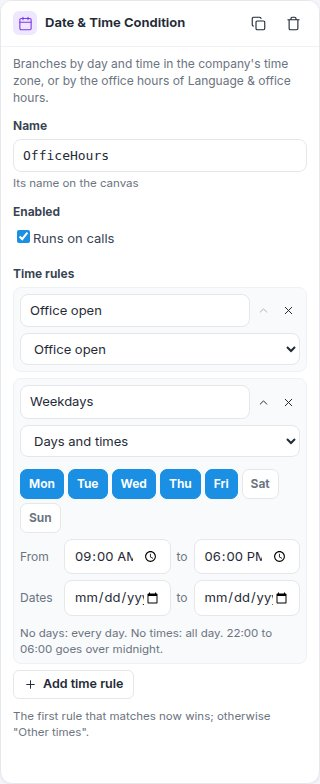

Each rule is one of:

| Rule | Matches |
|---|---|
| **Days and times** | The days you click (none clicked = every day), between two times (none = all day; 22:00 to 06:00 goes over midnight), and optionally between two dates (e.g. a promotion week). |
| **Office open** | When **Settings → Language & office hours** says you are open. |
| **Break time** | During the break hours set there. |
| **Holiday** | On a holiday set there. |
| **Outside office hours** | When it says you are closed. |

Using *Office open*, *Holiday* etc. means you change your hours in one place
(Language & office hours) and every call flow follows.

#### Loop

Repeats the components on its **Repeat** branch while a condition is true.

| Setting | Meaning |
|---|---|
| While | The condition, checked before each round, e.g. `Loop1.Index < 3` (three rounds: 0, 1 and 2) or `attempts < 3`. |
| At most (times) | A safety limit (default 10). |

`Loop1.Index` is the round number (0 for the first round).

#### Logger

Writes a line into the switch's log (level info, warning, error or debug),
e.g. `Caller ${session.ani} chose ${MainMenu.Result}`. Your technician sees
it with `journalctl -u ringqswitch -f` on the server, or in the live log of
the console (`rq_cli`). The caller hears nothing.

#### Exit Callflow

Ends the call flow here and hangs up normally. The disconnect handler runs
next.

### Application tools

#### HTTP Request

Calls a web address, for example your CRM, a booking system or a ticket
system, and keeps the answer.

| Setting | Meaning |
|---|---|
| Method | GET (read), POST (send), PUT, PATCH, DELETE, HEAD. |
| Address | e.g. `https://crm.example.com/api/caller?number=${URLENCODE(session.ani)}`. Must start with `http://` or `https://`. |
| Headers | Extra lines your system needs, e.g. **Authorization** = `Bearer <your key>`. Values may contain `${...}`. |
| Body type / Body | For POST, PUT, PATCH: what to send, e.g. `{"caller": "${session.ani}", "choice": "${MainMenu.Result}"}` as `application/json`. |
| Wait at most (seconds) | Default 10 (at most 60). The caller hears silence while waiting, so keep it short. |

**Branches:** **Success** (an answer below 400) and **Failure** (an error
answer such as 404 or 500, or no answer at all).
**Values:** `Http1.Status`, `Http1.Body`, `Http1.Error`.

#### JSON Parser

Most web systems answer in JSON, for example
`{"customer": {"name": "Tan Wei", "tier": "gold", "agents": ["1001", "1002"]}}`.
The JSON Parser takes one piece out of it.

| Setting | Example |
|---|---|
| JSON text | `Http1.Body` |
| Path | `customer.name` → `Tan Wei`; `customer.agents[0]` → `1001` (the first in a list) |

**Branches:** **Found**, **Not found**.
**Value:** `Json1.Value` (when the path points at a group, you get that part
as JSON text, which another JSON Parser can read).

#### Contact Lookup

Looks a number up in your company's **Contacts** (menu Contact center →
Contacts), matching the last 9 digits of the phone or mobile, so `+65 6123
4567` and `61234567` are the same.

| Setting | Meaning |
|---|---|
| Number | Empty: the caller's number. Or any value, e.g. `AskPhone.Buffer`. |

**Branches:** **Found**, **Not found**.
**Values:** `Contact1.Found`, `Contact1.Name`, `Contact1.Company`, `Contact1.Email`.

---

## 8. The three tabs: main flow, error handler, disconnect handler

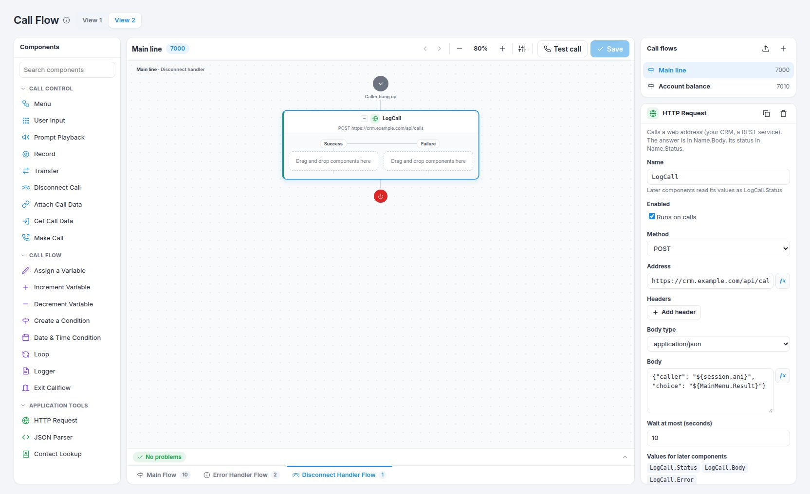

- **Main Flow**: what every caller goes through.
- **Error Handler Flow** runs when a component cannot do its job (for example
  a counter that is not a number, or a value that cannot be worked out).
  `session.lastError` says what went wrong. A good error handler plays
  "Sorry, we are having technical difficulties" and transfers to a person.
  After it, the call is hung up (unless it was transferred). With no error
  handler the call is simply hung up.
- **Disconnect Handler Flow** runs after the call ended inside the call flow
  (the caller hung up, or Disconnect Call / Exit, or the end of the main
  flow). The caller is gone, so the components that talk to the caller
  (Menu, User Input, Prompt Playback, Record, Transfer, Disconnect Call)
  cannot be used here; everything else can: variables, call data,
  conditions, Date & Time, loops, Logger, HTTP Request, JSON Parser,
  Contact Lookup and Make Call. Typical uses: send the result of the call
  to your CRM, or start a callback. It does not run when the call was
  transferred away.

---

## 9. Checking, saving and testing

**Checking.** While you work, the designer checks your call flow with the
same checks the switch uses. The bar under the canvas says **No problems**
or how many there are; click it for the list and click a problem to go to
the component. Typical problems: a Transfer with no destination, a Menu
with no keys, a value written wrongly.

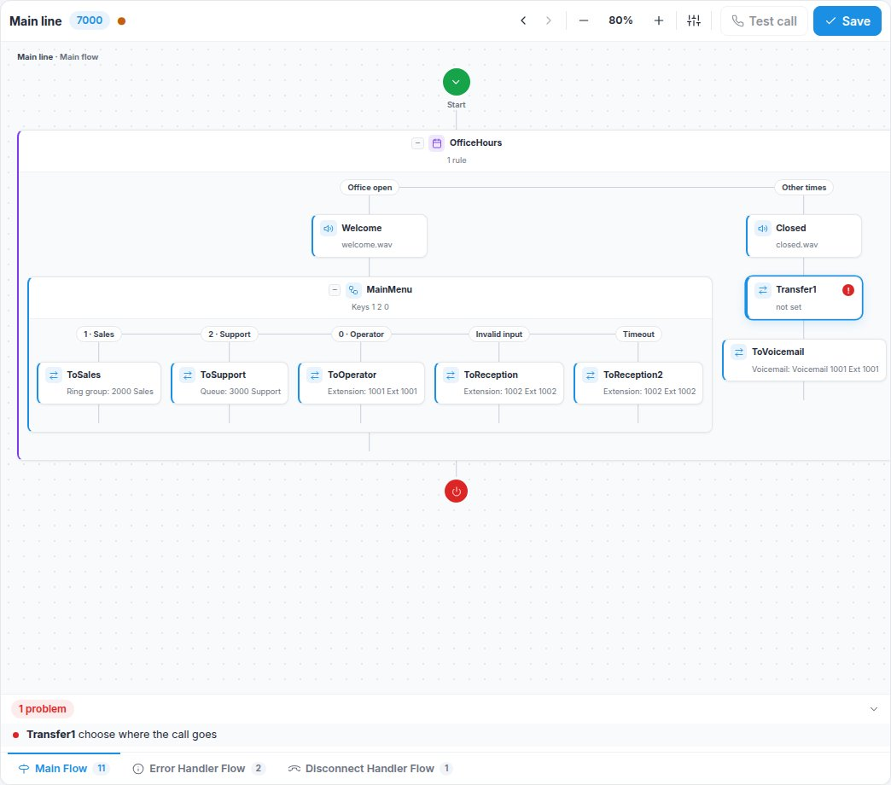

Orange **warnings** are hints (for example a value whose name the designer
does not know, maybe a typing mistake); the call flow still works.

**Saving.** Click **Save** or press **Ctrl S**. The message **Saved**
confirms it. Saving with problems is allowed ("Saved, with 1 problem"), so
you can finish later, but fix them before real callers use it: a component
with a problem may fail on calls (then the error handler runs) or do nothing.
A saved call flow takes calls straight away; nothing needs restarting.

If you go to another page and come back, your unsaved changes are still
there; if you close or reload the browser tab, your browser asks first.

**Testing.** **Test call** (after saving) rings the extension you are
signed in with (signed in as the administrator, you are asked which
extension); answer to go through the call flow. Or dial its number from
any phone. Afterwards, **Reports → Call history** shows each call's path
(open a call's row): the keys pressed, the branches taken, transfers.

**Switching off.** In the call flow's settings, untick **Enabled** and save:
its number no longer takes calls.

---

## 10. Sending your DID numbers to a call flow

In **Call Flow → View 1**, the **Call Flow Designs** card lists your call
flows. Drag a DID number (from *Available DID Numbers* or from another card)
onto it, choose the call flow in the window, and click **Assign**.

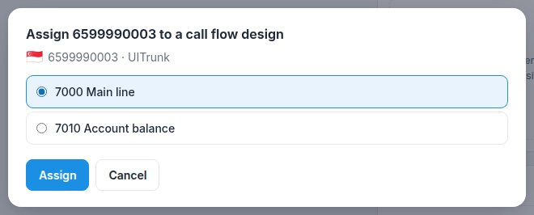

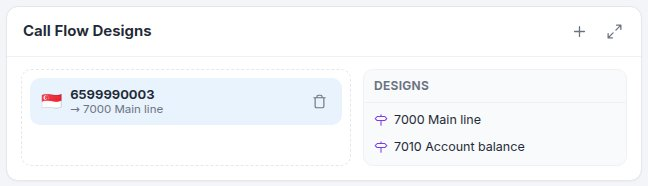

- To move the number elsewhere, drag it to another card. To stop using it,
  drag it back to *Available DID Numbers* (or click its bin).
- **+** on the card opens the designer on a new call flow; clicking a call
  flow in its list opens it in the designer.
- Call flows are also offered in every other "send calls to" list: an IVR
  menu option, a ring group's or queue's "when nobody answers", office-hours
  actions, a Transfer in another call flow.
- A call flow cannot be deleted while a DID still sends calls to it.

---

## 11. Ready-made examples

### A. Office hours, then a menu

1. **Date & Time Condition** *OfficeHours* with the rule **Office open**.
2. On *Office open*: **Prompt Playback** (welcome), then a **Menu**: 1 Sales
   (Transfer → Sales ring group), 2 Support (Transfer → Support queue),
   0 Operator; Invalid input and Timeout → Transfer to reception.
3. On *Other times*: **Prompt Playback** "We are closed", then **Transfer →
   Voicemail** of the reception.

### B. Account balance from your CRM

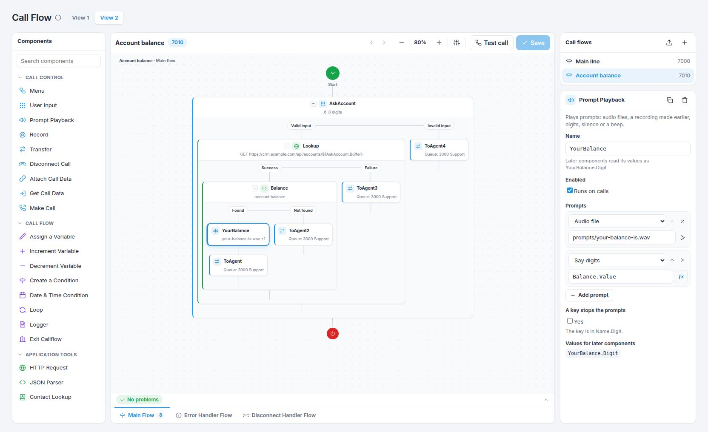

1. **User Input** *AskAccount*: 6 to 8 digits, then #.
2. On *Valid input*: **HTTP Request** *Lookup*, GET
   `https://crm.example.com/api/accounts/${AskAccount.Buffer}` with the
   header **Authorization** = `Bearer <your key>`.
3. On *Success*: **JSON Parser** *Balance*, JSON text `Lookup.Body`, path
   `account.balance`.
4. On *Found*: **Prompt Playback**: `prompts/your-balance-is.wav`, then *Say
   digits* `Balance.Value`; then **Transfer** to the support queue.
5. Every other branch (not found, failure, invalid input): **Transfer** to
   the support queue, so nobody is stuck.

### C. Known customers first

1. **Contact Lookup** (number empty = the caller).
2. On *Found*: **Attach Call Data** `customer` = `Contact1.Name` (the agent's
   screen can show it), then **Transfer → Priority queue**.
3. On *Not found*: **Transfer → General queue**.

### D. Leave a message and tell the team

1. **Record** with the prompt "Please leave your name, number and message",
   file name `msg-${session.callId}.wav`.
2. On *Audio recorded*: **Prompt Playback** "Thank you", then **HTTP
   Request** POST to your ticket system with the body
   `{"caller": "${session.ani}", "file": "${Record1.FileName}", "seconds": "${Record1.Duration}"}`.
3. **Disconnect Call**.

### E. Ask to be called back

1. Variable `callback` = `no` (call flow settings).
2. A **Menu** offering "press 2 to be called back".
3. On key 2: **Assign a Variable** `callback` = `"yes"`, **Prompt Playback**
   "Thank you, we will call you back in a few minutes", **Disconnect Call**.
4. On the **Disconnect Handler Flow** tab: **Create a Condition** with the
   branch `callback == "yes"`, and on it **Make Call**: ring first `1001`
   (the sales desk), then connect to `${session.ani}`. When the sales desk
   answers, the customer's phone rings.

### F. Three tries, then a person

1. Variable `attempts` = `0` (call flow settings).
2. **Loop** *While* `attempts < 3`, and inside it: **User Input** *AskPin*;
   on *Valid input* a **Create a Condition** that checks the PIN (for example
   with your system through an HTTP Request) and **Transfer**s when it is
   right; on *Invalid input* **Increment Variable** `attempts`.
3. After the loop: **Transfer** to reception.

### G. A special greeting on public holidays

1. **Date & Time Condition** with the rules **Holiday** (first) and **Office
   open**.
2. On *Holiday*: **Prompt Playback** with your holiday message, then
   **Transfer → Voicemail**.
3. Holidays are entered once in **Settings → Language & office hours**.

### H. Write every call into your CRM

On the **Disconnect Handler Flow** tab: **HTTP Request** POST to your CRM
with `{"caller": "${session.ani}", "did": "${session.did}", "choice": "${MainMenu.Result}", "started": "${session.startTime}"}`.

---

## 12. Copying, moving and deleting call flows

Click an empty part of the canvas to see the **call flow's settings**; at
the bottom:

- **Duplicate** makes a copy with a new name and number (to try changes
  without touching the live one).
- **Export** downloads the call flow as a file (`.json`). **Import** (the
  arrow above the list of call flows) makes a new call flow from such a
  file, on this server or another one.
- **Delete** removes the call flow (not possible while a DID sends calls to
  it).

The **Name**, **Number** and **Description** can be changed there too
(then **Save**).

---

## 13. When something does not work

| What you see | Why, and what to do |
|---|---|
| Calls to the number are refused | The call flow is switched off (call flow settings → Enabled), or it has not been saved yet. |
| The caller hears nothing where a prompt should be | The file name is wrong or the file was not uploaded. Click **▶** next to the prompt: if it does not play, upload it in **Settings → Sounds & music**. |
| A key does nothing in the menu | The key is not turned on under **Keys**, or **Keys stop the prompts** is off and the caller pressed during the prompt. |
| The menu always goes to Timeout | The caller's phone sends keys in a way the carrier drops; test from an extension. Check **Wait for a key**. |
| HTTP Request always takes Failure | Look at `Http1.Status` and `Http1.Error` with a **Logger** (`${Http1.Status} ${Http1.Error}`): 0 means the address could not be reached from the server (address, firewall); 401/403 a wrong key; 404 a wrong address. Test the address from the server with `curl`. |
| JSON Parser takes Not found | The path does not match the answer. Log `${Http1.Body}` with a Logger and copy the names exactly (capitals count). |
| "the name ... is used by another component" | Two components cannot have the same name; rename one. |
| "A component cannot go inside itself" | You dropped a component into one of its own branches. |
| Make Call fails at once | "Ring first" and "Then connect to" must end up as numbers (digits, +, \*, #). Log them to check. |
| A component is refused in the disconnect handler | Menu, User Input, Prompt Playback, Record, Transfer and Disconnect Call need the caller, who has gone by then. Move them to the main flow. |
| Where can I see what happened on a call? | **Reports → Call history**, open the call's row: its path lists the call flow's steps. Logger lines are in the switch's log. |

---

## 14. Keyboard shortcuts

| Keys | Does |
|---|---|
| **Ctrl S** | Save |
| **Ctrl Z** / **Ctrl Y** (or **Ctrl Shift Z**) | Undo / redo |
| **Delete** | Delete the selected component |
| **Ctrl C** / **Ctrl V** | Copy the selected component / paste it after the selected one |
| **Esc** | Select nothing (shows the call flow's settings) |
| **Enter** on a component in the list on the left | Add it |

On a Mac use **Cmd** instead of **Ctrl**. Shortcuts work while the canvas
has the focus (not while you are typing in a field).
